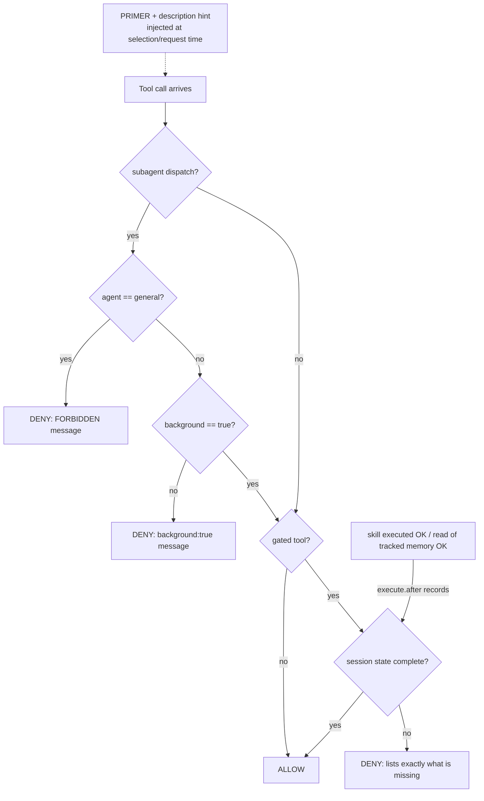

<h1 align="center">🛡️ opencode-mandator</h1>

<p align="center"><b>Deterministic enforcement for OpenCode v2 — the owner's dispatch policy as a plugin, so the model cannot forget it.</b></p>

<p align="center">
  
  
  
  
</p>

<p align="center">
  <a href="#-what-is-enforced">What is enforced</a> ·
  <a href="#-architecture">Architecture</a> ·
  <a href="#-quick-start">Quick Start</a> ·
  <a href="#-installverifyuninstall">install.sh</a> ·
  <a href="#-security-notes">Security notes</a> ·
  <a href="#-design-rationale">Design rationale</a>
</p>

---

## 📖 What is enforced

Five deterministic layers, enforced in-process by an OpenCode v2 plugin
(`@opencode/plugin` `Plugin.define`). Full normative spec: [`docs/RULES.md`](docs/RULES.md).

| :-- | # | Rule | Scope |
| :-- | :-- | :-- | :-- |
| :-- | 1 | `agent: "general"` dispatches are **FORBIDDEN** | `subagent`, any session state |
| :-- | 2 | Every dispatch requires **`background: true`** — deny, never rewrite | `subagent`, strict (`false` and omitted both deny) |
| :-- | 3 | **Skill gate**: calls denied until the session loaded `brainstorming` + `grilling` + `build-with-exa` via `skill`… | `edit`, `write`, `shell`, `bash`, `apply_patch`, `subagent`, `webfetch`, `websearch`, `execute`, any `*exa*` MCP tool |
| :-- | 4 | **Memory gate**: …and read `~/.config/opencode/MEMORY.md`; dispatches additionally need `subagent-driven-development` + `dispatching-parallel-agents` + reads of `memory/topics/workflow.md` + `workflow-git-pr.md` | same gated set (+ orchestrator preflight on `subagent`) |
| :-- | 5 | **PRIMER** injected as a system text part before every model request + one-line policy hint on the `subagent` tool description | every agent request / tool selection |

Deny messages list **exactly what is missing** and end with the comply-then-rerun
instruction. Absolute bans (rules 1–2) are checked before the skill gate.

## 🗺 Architecture



**Request-flow 1 — compliance cycle (any gated call):**

1. Gated call arrives → plugin checks the calling session's recorded state.
2. **DENY** — the message lists exactly the missing skills/reads; nothing ran.
3. The agent invokes `skill` for each missing skill and `read`s the missing memory files.
4. The **same call is re-run unchanged** → state complete → **ALLOW**.

**Request-flow 2 — orchestrator preflight (a `subagent` dispatch):**

1. Ban checks first: `agent: "general"` → deny; `background !== true` → deny.
2. Base gate: 3 skills + `MEMORY.md` read must already be in session state.
3. Dispatch gate: + `subagent-driven-development`, `dispatching-parallel-agents`,
   `workflow.md`, `workflow-git-pr.md` reads.
4. All present → dispatch proceeds; anything missing → one exact-missing deny.

## 📂 Project Structure

```text
opencode-mandator/
├── src/
│   └── dispatch-policy.ts      # the plugin — byte-migrated from the live file, single source of truth
├── tests/
│   ├── dispatch-policy.test.ts # bun test port of the probe suite (real module + mock ctx)
│   └── probe-original.ts       # the original /tmp probe script, kept as provenance (not run by bun test)
├── docs/
│   └── RULES.md                # normative enforcement spec: gated set, prerequisites, deny messages
├── install.sh                  # atomic install (symlink-first, --copy, verify, uninstall)
├── README.md
├── package.json                # private; scripts: test = bun test; devDep @opencode/plugin
└── .gitignore                  # node_modules, *.log
```

## 🚀 Quick Start

1. **Test** the plugin logic: `bun install && bun test` — the probe-port suite must be green.
2. **Install** (atomic, symlink-first): `./install.sh` — or force a byte-copy with `./install.sh --copy`.
3. **Verify**: `./install.sh verify` — installed mode, byte-parity, and `opencode plugin list` registration.
4. **Use it**: in any OpenCode session, a gated call is denied with the exact missing list —
   invoke the listed `skill`s, `read` the listed memory files, re-run the call unchanged.
5. **Uninstall** (gate disarms): `./install.sh uninstall`.

## ⚙️ Install/Verify/Uninstall

| :-- | Command | Effect |
| :-- | :-- | :-- |
| :-- | `./install.sh` | Tries **symlink** (single source of truth: the repo file IS the live plugin), probes the loader via `opencode plugin list` (3 attempts, 2s apart), falls back to an **atomic copy** if the loader refuses the symlink. |
| :-- | `./install.sh --copy` | Skips the symlink attempt; installs a byte-copy. |
| :-- | `./install.sh verify` | Reports installed mode + byte-parity vs `src/` + loader registration. Non-zero exit on drift. |
| :-- | `./install.sh uninstall` | Removes the live file (documented unlock; the gate is fail-open while the file is absent). |

**Live probe verdict (this machine, OpenCode v2.0.27): SYMLINK MODE WORKS.**
`opencode plugin list` registers `dispatch-policy` through a symlinked plugin file, so
the default install is a symlink to `src/dispatch-policy.ts` — the repo is the single
source of truth. History of the probe: the first installer revision probed exactly once,
immediately after each atomic `mv`, and both probes failed (symlink AND the copy
fallback) — yet a manual `opencode plugin list` seconds later registered the plugin.
Root cause: probe race, not symlink rejection. After adding the retry loop, the symlink
probe passes deterministically. `install.sh` still keeps the automatic copy fallback
for machines whose loader behaves differently.

**Hot-reload nuance (observed live 2026-10-14):** installing by atomic *rename*
(`mv -Tf` replacing the path) did **not** trip the running server's plugin watcher —
the running server kept its previously loaded module and per-session gate state
(gated calls kept passing with pre-install compliance). Fresh `opencode` processes
(f.e. `plugin list`) load the new file immediately. In-place content edits of the
plugin file are the known hot-reload trigger (and wipe per-session gate state —
fail-closed by design).

## 🔒 Security notes

- **Atomic writes or nothing.** OpenCode hot-reloads plugin files on change; a broken
  interim file at the live path fail-closes **every** gated call with no in-session
  recovery (all writers are gated). `install.sh` materializes a temp entry in the same
  directory and installs with one `mv -Tf` — never edit the live file in place.
- **Kill switch.** `OPENCODE_ENFORCE_OFF=1` disables all plugin behavior — but it is
  read from the server process env at hook-call time, so it only affects **future**
  server starts. The immediate off-switch is removing the file (hot-reload unloads it).
- **Fail-closed by design.** Server restart or plugin hot-reload wipes per-session
  compliance state — sessions re-gate. A broken hook build denies everything (safe
  direction); recovery is `rm ~/.config/opencode/plugin/dispatch-policy.ts` + reinstall.
- **Recording is honest.** Only `status: "completed"` skill loads and reads of tracked
  memory files count; failed invocations never count; state is strictly per-session.

## 🧭 Design rationale

- **Deterministic hooks > prose.** The policy lived in memory files and prompts; models
  forget. Hooks in `execute.before` cannot be forgotten — the denial happens before the
  tool runs, and the deny message teaches the rule (honest failure, never silent rewrite).
- **Memory-restart = fail-closed.** Per-session in-memory state is deliberate: no
  persistence path exists that could let a stale "compliant" flag survive a restart.
  The cost — one compliance round per session/hot-reload — is accepted by design.
- **Byte-migration, no refactors.** `src/dispatch-policy.ts` is the battle-tested live
  plugin moved verbatim (231 lines, `cmp`-identical); behavior changes only via tested
  edits in this repo.

## ✅ Testing

`bun test` runs `tests/dispatch-policy.test.ts`: the wave3-a2 probe suite ported 1:1
(same events, sessions, and state-mutation order) against the real `@opencode/plugin`
`Plugin.define` wrapper with a mock ctx — gated sets, deny messages, partial
compliance, whitelist, per-session isolation, kill switch, primer, description hint.

---

<p align="center"><sub>Owner: 4q4r · No LICENSE file yet (owner decides) · Local git only, no remote.</sub></p>
